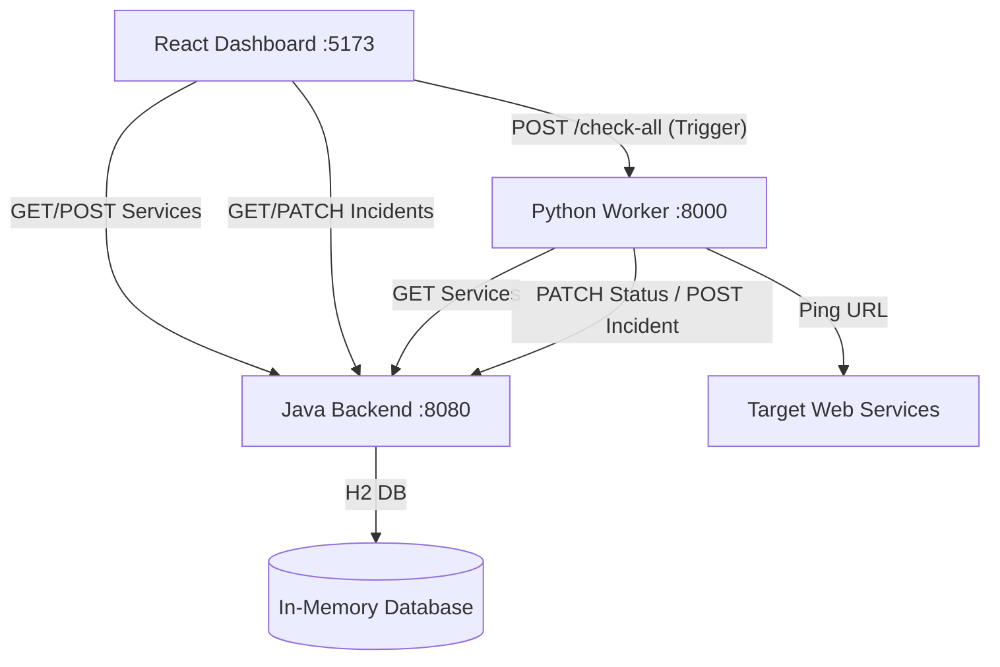

# DevPulse – Microservice Monitoring & Incident Management

DevPulse is a full-stack microservice system designed to monitor web service availability and manage incidents through a unified dashboard.

## 🏗 Architecture & Data Flow

The system consists of three decoupled services interacting via REST APIs:



- **Frontend (React)**: User interface for monitoring and service management.
- **Worker (Python)**: Active health-check engine that pings services and reports results.
- **Backend (Java)**: Core persistence layer and REST API for services and logs.

## 🛠 Tech Stack

- **Backend**: Java 17, Spring Boot, Spring Data JPA, Maven, H2 (In-Memory).
- **Worker**: Python 3.12+, FastAPI, HTTPX, Pytest.
- **Frontend**: React, Vite, TypeScript.

---

## 🚀 Getting Started

### 1. Java Backend (Port 8080)
```bash
cd backend-java
./mvnw clean spring-boot:run
```
*Tests:* `./mvnw test`

### 2. Python Worker (Port 8000)
```bash
cd worker-python
# Create and activate venv if needed
pip install -r requirements.txt
uvicorn main:app --port 8000
```
*Tests:* `python -m pytest`

### 3. React Frontend (Port 5173)
```bash
cd frontend-react
npm install
npm run dev
```
*Build:* `npm run build`

---

## 📋 Features
- **Live Dashboard**: View current status (UP/DOWN/UNKNOWN) of all services.
- **Service Management**: Add new URLs to the monitoring list.
- **Manual Trigger**: Run health checks across all services with one click.
- **Incident Logs**: Track and resolve downtime incidents.

## 📝 Rules & Standards
- **CORS**: Configured for Port 5173 across all APIs.
- **Architecture**: Strict layer separation (Controller/Service/Repository) in the backend.
- **Quality**: Unit and integration tests included for both backend services.
